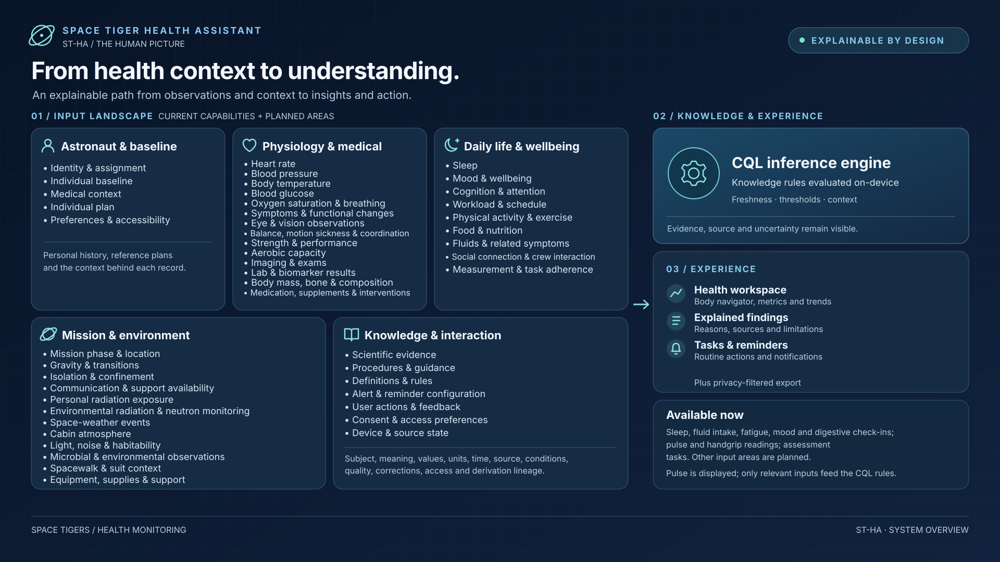

# Space Tiger Health Assistant (ST-HA)

**Mission health, understood.** ST-HA is a local-first astronaut health-monitoring demonstration for the [NASA Space Apps Challenge](https://www.spaceappschallenge.org/2026/challenges/health-monitoring-software/).

**[Open the web app](https://mertk26.github.io/ST-HA/)** · [Android phone APK](./public/app-debug.apk) · [Wear OS watch APK](./public/wear-debug.apk)

[Watch the demo video](./public/st-ha-demo.mp4) · [View the presentation](./public/st-ha-presentation.pptx)

[](./public/st-ha-demo.mp4)

## What it does

- Brings health observations and daily check-ins into a dashboard with trends and a body navigator.
- Uses CQL rules to produce explainable findings linked to observations and an evidence library.
- Supports routines, a history timeline, and a Scenario Lab that previews changes without saving them.
- Provides a responsive mobile experience and Android reminders; watch notification delivery depends on the device and configuration.

## Run locally

Requires Node.js 22.18 or newer.

```powershell
npm ci
npm run compile:cql
npm run dev
```

Open the address printed by Vite. Run `npm run build` to create a production build.

## Sources and documentation

NASA resources inform the app's evidence and explanations, not its fictional measurements:

- [Human-performance requirements](https://www.nasa.gov/reference/4-0-human-performance/) inform the strength-maintenance discussion and comparison of handgrip with a fictional baseline. One handgrip result does not assess whole-body strength.
- [Medical operations](https://www.nasa.gov/reference/6-0-medical-operations/) inform the sleep and mission-schedule context. The app's eight-hour example is a demonstration target, not a NASA diagnostic cutoff.
- [Human Research Program risks](https://www.nasa.gov/hrp/risks/) provide context for considering health across the whole person.

- [Architecture and research documentation](./research/README.md)
- [CQL knowledge library](./knowledge/Hecatron.cql)
- [System overview](./public/st-ha-how-it-works.svg)

The application was developed with AI assistance. Video narration uses the [Piper Amy voice model](https://huggingface.co/rhasspy/piper-voices/tree/main/en/en_US/amy/medium). The supplied [Space Tigers logo](./public/space-tiger-team.jpg) is credited to its [Space Apps asset](https://assets.spaceappschallenge.org/media/images/1000065244.2e16d0ba.fill-300x250.jpg). Third-party dependencies retain their respective licenses.

## Important limitations

This is a fictional demonstration, not a medical device or clinical advice. Profiles, readings, and plans are synthetic; example ranges are not clinical or safety limits. There are no connected sensors or backend, and local sign-in is not authentication. NASA has not validated or endorsed ST-HA. Physical phone and watch notification delivery has not been verified.
